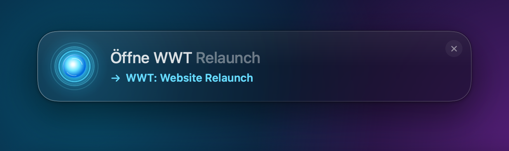
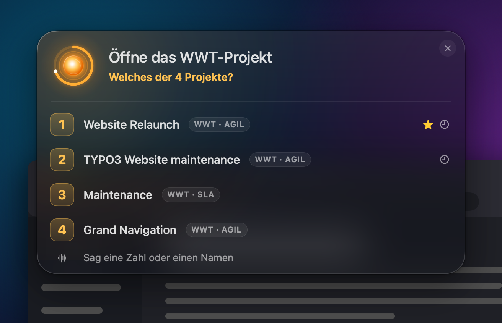

# AC Voice

**Voice control for ActiveCollab on macOS.** Tap a Stream Deck key or press ⌃⌥Space, say what you need, and Chrome shows the project, the ticket or your task list. AC Voice reuses the ActiveCollab tab you already have open. It understands English and German.

<p align="center">
  
</p>

## Features

- **Speak, don't click.** "Open the WWT project", "Open WWT ticket 412", "My tasks".
- **English or German.** The menu, the setup window, the overlay, the voice commands and the speech recognition follow the language of macOS. The `language` setting overrides it (see [Language](#language)).
- **On-device speech recognition.** Apple's SpeechAnalyzer runs on your Mac. No audio and no transcript leave it.
- **Never guesses.** When several projects fit, a numbered list appears. Answer "two", say a word from the title or click a row.
- **Reuses your tab.** AC Voice finds the ActiveCollab tab in Chrome and loads the page there.
- **Stream Deck key with live state** or a global hotkey. Tap to talk, or hold the key while you speak.
- **Read-only.** AC Voice only reads from ActiveCollab. The single write is the sign-in, which asks ActiveCollab to issue an API token for AC Voice.

<p align="center">
  
  
</p>

## How it works

```
Stream Deck key / ⌃⌥Space / menu bar
        │
        ▼
AC Voice.app (menu bar, always running)
  overlay with live transcript
  on-device speech recognition (English or German)
  resolver over a local index of projects and tasks (read-only ActiveCollab API)
        │
        ▼
Google Chrome: reuse the ActiveCollab tab, else open a new tab
```

ActiveCollab URLs contain internal ids, not the ticket numbers you say. AC Voice keeps a small local index (projects, favorites, your open tasks, ticket numbers per project) and refreshes it on every key press, so new tickets and projects show up right away.

## Requirements

- macOS 26 or later on Apple silicon. macOS downloads the speech model of the app language (English or German) on first use.
- Google Chrome, logged in to ActiveCollab in a normal (not incognito) window.
- Xcode 27 or its command line tools (Swift 6.4) to build.
- An Apple Development signing identity (free with an Apple ID in Xcode).
- An ActiveCollab account. You sign in with your email address and password, or with an API token for single sign-on setups.
- Optional: the Stream Deck app 7.1 or later, and npm to build the plugin.

## Installation

### 1. Signing identity

macOS ties the microphone and automation permissions to the app's signature. A stable signing identity keeps them across updates.

1. In Xcode, open Settings > Accounts > Manage Certificates > "+" > Apple Development.
2. Remove revoked or expired "Apple Development" certificates from the login keychain. macOS refuses to launch an app signed with a revoked one.
3. Check which identity the build picks:

   ```sh
   scripts/bundle.sh --check-identity
   ```

No Apple ID? Create a self-signed "Code Signing" certificate in Keychain Access (Certificate Assistant > Create a Certificate) and build with `SIGN_ID="<certificate name>"`.

### 2. Build and install

```sh
git clone https://github.com/nordavid/ac-voice.git
cd ac-voice
scripts/install.sh --dry-run   # shows every step, changes nothing
scripts/install.sh
```

`install.sh` builds a signed release, installs it to `~/Applications/AC Voice.app` and starts it in the background. Run it again after every update. It quits the running copy first.

### 3. First start

The window "Set Up AC Voice" opens on its own. Work through its rows from top to bottom.

| Row | What to do |
|---|---|
| **ActiveCollab** | Enter the web address of your ActiveCollab in "AC address", for example `https://ac.example.test`. Enter your email address and password and click "Sign In". ActiveCollab issues an API token for AC Voice, and AC Voice keeps it in your login keychain. It never stores the password. With single sign-on, open "Sign In with a Token", paste an API token and click "Save". |
| **Microphone** | Click "Allow Microphone" and allow the macOS prompt. |
| **Chrome** | Start Chrome, click "Allow Control" and allow the prompt. Without it AC Voice still works, but opens every page in a new tab. |
| **Speech Model** | Click "Test Speech Recognition". It checks the speech model of the app language, and the row shows how fast recognition responds. If the test fails because macOS never asked for speech recognition, the row offers "Allow Speech Recognition". |
| **Stream Deck** | Shows whether the plugin is connected. "Copy Commands" puts the install commands of [step 4](#4-stream-deck-key-optional) on the clipboard. |
| **Autostart** | Turn on "Start at login" to start AC Voice at login. |

The Microphone and Chrome rows offer "Open System Settings" after you deny a permission. For speech recognition, open System Settings > Privacy & Security > Speech Recognition yourself. Click "Done" when you are through. The text left of the button tells you how to try AC Voice, for example "Press ⌃⌥Space and say “my tasks”."

The address field replaces any manual setup. AC Voice writes the address to `config.json` and uses it right away. Once you are signed in, the row names the host AC Voice uses. To sign in again or change the address later, click "Sign In Again or Change the Address" in that row. You can also set `acBaseURL` in `config.json` yourself before the first start (see [Configuration](#configuration)). The token looks like `<user id>-<key>`, and AC Voice takes your user id from it.

The macOS permission prompts (microphone, speech recognition, Chrome control) follow the language of macOS, not the `language` setting.

### 4. Stream Deck key (optional)

```sh
cd streamdeck
npm install
npm run build
npm run link
```

Restart the Stream Deck app, then drag the action **AC Voice** from the category "AC Voice" onto a key. One key is enough. The key shows what AC Voice does, with captions in the app language:

<p align="center">
  
</p>

## Usage

### Start and stop

| Action | Effect |
|---|---|
| Tap the key or press ⌃⌥Space | AC Voice listens and detects the end of your sentence on its own. |
| Hold the key while you speak | Push-to-talk. Releasing the key ends the sentence. |
| Press again while listening | After you spoke, finish now. Before you spoke, cancel. |
| Press while a list shows | Close the list. |
| Esc | Cancel and close the overlay, at any time. A page Chrome is already opening still appears. |

**Tap or hold?** Tap for almost everything. Hold when you pause mid-sentence, for example to look up a ticket number, or when the room is loud.

### Commands

Speak in the app language (see [Language](#language)). The tables below show the English commands. [German commands](#german-commands) lists the German ones. The examples use the fantasy project code "WWT". Say the codes of your own projects.

| You say | AC Voice opens |
|---|---|
| "WWT Relaunch", "Open WWT Relaunch" | the project, if exactly one fits |
| "Open the WWT project" | a list of all WWT projects, most likely first |
| "Open WWT ticket 412", "Ticket 412 in WWT Relaunch" | ticket #412 in that project |
| "Ticket 47285", "Open 47285" | the ticket with this id, in whatever project it lives |
| "Ticket 412" | your own open ticket #412, otherwise a list of projects with a #412 |
| "My tasks", "What's on my plate" | the tasks assigned to you |
| "Cancel", "Never mind", "That's all" | nothing, the overlay closes |

Say ticket numbers in parts ("four twelve", "four one two") or in full ("four hundred twelve"). Spell project codes letter by letter, as you would say them to a colleague, for example "double-u double-u tee" or "W W T".

### Answering a list

| You say | Effect |
|---|---|
| "two", "the second", "number two" | open row 2 |
| "the last one" | open the last row |
| a word from a title, for example "Relaunch" | open the matching row, or narrow the list |
| "more", "next" | show the next rows |
| "yes", "go ahead" or "no", when the list has one row | open the row, or close the list |
| "Cancel", "None of them" | close the list |
| "Wait a second", "Hang on" | keep listening |
| a new command | start over |

You can also click a row. While the pointer rests on the list, its countdown pauses.

The icons in a row show why it ranks high:

| Icon | Meaning |
|---|---|
| ★ | the project is one of your ActiveCollab favorites |
| 👤 | the ticket is assigned to you |
| 🕘 | you tracked time on the project or opened it with AC Voice in the last 30 days |
| 🗄 | the ticket is completed |

These signals only sort the list. AC Voice never opens a project without asking.

### German commands

When the app language is German, AC Voice listens for German commands. It works the same way.

| English | German |
|---|---|
| "Open WWT Relaunch" | "Öffne WWT Relaunch" |
| "Open the WWT project" | "Öffne das WWT-Projekt" |
| "Open WWT ticket 412" | "Öffne WWT Ticket 412" |
| "Ticket 412 in WWT Relaunch" | "Ticket 412 im WWT Relaunch" |
| "Open 47285" | "Öffne 47285" |
| "My tasks", "What's on my plate" | "Meine Aufgaben", "Was steht an" |
| "Cancel" | "Abbrechen" |
| "two", "the second", "number two" | "zwei", "die zweite", "Nummer zwei" |
| "the last one" | "die letzte" |
| "more" | "mehr" |
| "yes", "no" | "ja", "nein" |

Spell codes with German letter names, for example "We We Te". Say numbers in German, for example "vier zwölf" or "vierhundertzwölf". "Wait a second" has no German counterpart.

### Menu bar

The top of the menu shows the current state, for example "Ready" or "Sign in to AC in the setup window".

| Item | Effect |
|---|---|
| Listen | start listening, like the key |
| Refresh Index | reload projects and tickets now |
| Set Up… | open the setup window |
| Start at Login | start at login on or off |
| Open Login Items… | shows only while macOS waits for your approval of the login item |
| Diagnostics | test speech recognition and Chrome, show an overlay demo, copy a status report |
| Quit | quit AC Voice |

## Language

AC Voice runs in English or German. The language applies to the menu, the setup window, the overlay, the Stream Deck key, the voice commands and the speech recognition. Set it with `language` in `config.json`:

| Value | Language |
|---|---|
| `auto` (default) | German when the first preferred language of macOS is German, English for every other language |
| `en` | English |
| `de` | German |

AC Voice reads the setting at launch. Restart AC Voice after a change.

macOS downloads the speech model of the chosen language on first use. "Test Speech Recognition" in the setup window checks that model. The macOS permission prompts always follow the language of macOS.

## Configuration

Settings live in `~/Library/Application Support/ac-voice/config.json`. Every key is optional. The setup window writes `acBaseURL` and `launchAtLogin` and applies them at once. Restart AC Voice after you edit the file yourself.

| Key | Default | Meaning |
|---|---|---|
| `acBaseURL` | `https://ac.example.com` (placeholder) | your ActiveCollab web address (https), set by the "AC address" field |
| `language` | `auto` | app language, `auto`, `en` or `de` (see [Language](#language)) |
| `userId` | from the token | your ActiveCollab user id, only for a token without the `<user id>-` prefix. A token with the prefix wins |
| `myTasksPath` | `/users/{me}/tasks` | page for "My tasks" |
| `aliases` | `{}` | words speech recognition hears instead of a project code |
| `synonyms` | `{}` | title words for a word you say. The key is the spoken word, the list holds the title words it stands for (the reverse of `aliases`) |
| `learnAliases` | `true` | learn an alias when you pick the same project twice for the same words |
| `hotkey` | ⌃⌥Space | the shortcut, see below |
| `earcons` | `true` | short sounds for listening, done and error |
| `inputDeviceUID` | system default | the microphone to use |
| `avoidBluetoothInput` | `true` | use the built-in microphone when the default input is Bluetooth |
| `visibleChoices` | `6` | rows per page in a list |
| `choicesWindow` | `6.0` | seconds a list waits for your answer |
| `launchAtLogin` | `false` | mirrors the autostart switch |
| `chromeActivation` | `appleScript` | how Chrome comes to the front, `appleScript`, `runningApplication` or `workspace` |
| `overlayBackdrop` | `liquidGlass` | overlay background, `liquidGlass`, `appKitGlass` or `hudMaterial` |

**Aliases.** Speech recognition hears some codes as ordinary words, and the words differ between English and German. Map them to the code as written in ActiveCollab. This example is for German speech recognition, which hears "IBN" as "eben".

```json
{
  "aliases": { "IBN": ["eben"], "S+K": ["eska"] },
  "synonyms": { "armaturenbrett": ["cockpit"] }
}
```

With `"armaturenbrett": ["cockpit"]` you can say "Armaturenbrett" for a title with "Cockpit". AC Voice already knows common German words for English title words, such as "Wartung" for "Maintenance".

**Shortcut.** This example sets ⌘F5.

```json
{
  "hotkey": { "keyCode": 96, "modifiers": 256 }
}
```

`keyCode` is the Carbon key code (Space 49, F1 to F12 122, 120, 99, 118, 96, 97, 98, 100, 101, 109, 103, 111). `modifiers` is the sum of ⌘ 256, ⇧ 512, ⌥ 2048, ⌃ 4096. `"enabled": false` turns the shortcut off.

**Other files.**

| Path | Content |
|---|---|
| `~/Library/Application Support/ac-voice/history.json` | your picks and opens, used for the order of lists |
| `~/Library/Caches/io.github.nordavid.acvoice/index.json` | the local index with project names, ids and ticket numbers |
| login keychain, service `io.github.nordavid.acvoice`, name "AC Voice API-Token" | the ActiveCollab token, one item per ActiveCollab host (and port, when it is not 443) |

## Troubleshooting

**The app does not start after install.** Run `scripts/bundle.sh --check-identity`. A revoked certificate passes `codesign --verify` but fails at launch.

**A permission prompt never appears.** After a change of the signing identity the old permissions no longer match. Reset them and start AC Voice again:

```sh
tccutil reset Microphone io.github.nordavid.acvoice
tccutil reset SpeechRecognition io.github.nordavid.acvoice
tccutil reset AppleEvents io.github.nordavid.acvoice
```

**Chrome opens a new tab every time.** Allow the Chrome control in the setup window, and keep ActiveCollab in a normal window. AC Voice ignores incognito windows.

**The menu shows "AC rejects the token".** The token expired or was revoked. Open Menu > "Set Up…". The ActiveCollab row shows the sign-in form again. Sign in with your email address and password, or use "Sign In with a Token".

**The setup window shows "AC rejects the email or password".** Check the address, the email address and the password. Accounts with single sign-on have no password for the API. Use "Sign In with a Token" for them.

**The setup window shows "AC is not responding at this address".** The host does not exist, refuses the connection, shows a certificate that does not fit, or is not ActiveCollab. Enter the address you open ActiveCollab with in the browser, for example `https://ac.example.test`, not the address of your company website.

**AC Voice runs in the wrong language.** Set `language` in `config.json` to `"en"` or `"de"` and restart AC Voice.

**Keychain asks for access to "AC Voice API-Token".** This happens once after a change of the signing identity. Choose "Always Allow".

**⌃⌥Space does nothing.** macOS may use it to switch input sources. Turn that off in System Settings > Keyboard > Keyboard Shortcuts > Input Sources, or set another `hotkey`.

**Poor recognition with AirPods.** Bluetooth headsets switch to a low-quality mode when the microphone starts. AC Voice uses the built-in microphone in that case.

**Something else.** Menu > Diagnostics > "Copy Diagnostics" puts a short status report on the clipboard. It holds versions, permissions, index state and timings, never the token or a transcript. The app logs to the unified log:

```sh
/usr/bin/log stream --predicate 'subsystem == "io.github.nordavid.acvoice"' --level info
```

## Privacy

- Speech recognition runs on your Mac. No audio goes to a server, and AC Voice stores no recordings.
- The microphone is on only while the overlay listens. The orange dot in the menu bar shows it.
- Transcripts never appear in logs.
- AC Voice reads only. The single write is the sign-in, which asks ActiveCollab to issue an API token for AC Voice in your account. You can revoke that token in ActiveCollab at any time.
- AC Voice sends your password once, over https, to your ActiveCollab for the sign-in. It never stores or logs the password.
- The token stays in your login keychain and never appears in logs.
- Network traffic goes to your ActiveCollab only. No analytics, no telemetry.

## Development

Build, tests, speech test fixtures, developer tools and packaging are in [docs/DEVELOPMENT.md](docs/DEVELOPMENT.md). Architecture and decisions are in [docs/PLAN.md](docs/PLAN.md).
