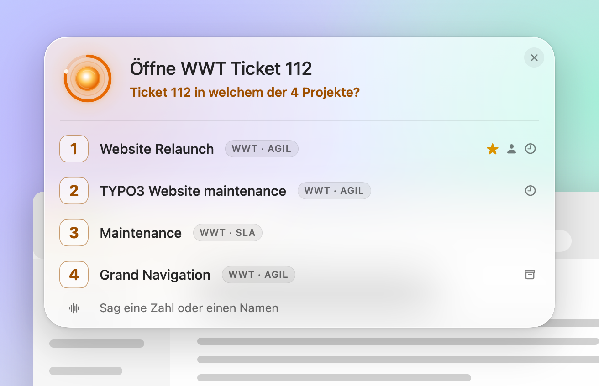
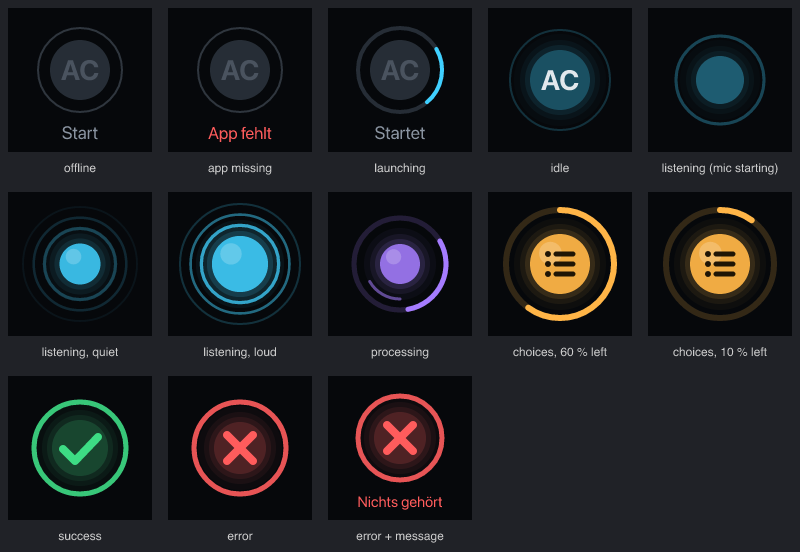

# AC Voice

**Voice control for ActiveCollab on macOS.** Tap a Stream Deck key or press ⌃⌥Space, say what you need in German, and Chrome shows the project, the ticket or your task list. AC Voice reuses the ActiveCollab tab you already have open.

<p align="center">
  
</p>

## Features

- **Speak, don't click.** "Öffne das WWT-Projekt", "Öffne WWT Ticket 412", "Meine Aufgaben".
- **On-device speech recognition.** Apple's SpeechAnalyzer runs on your Mac. No audio and no transcript leave it.
- **Never guesses.** When several projects fit, a numbered list appears. Answer "zwei", say a word from the title or click a row.
- **Reuses your tab.** AC Voice finds the ActiveCollab tab in Chrome and loads the page there.
- **Stream Deck key with live state** or a global hotkey. Tap to talk, or hold the key while you speak.
- **Read-only.** AC Voice only reads from ActiveCollab and never changes anything there.

<p align="center">
  
  
</p>

## How it works

```
Stream Deck key / ⌃⌥Space / menu bar
        │
        ▼
AC Voice.app (menu bar, always running)
  overlay with live transcript
  on-device speech recognition (German)
  resolver over a local index of projects and tasks (read-only ActiveCollab API)
        │
        ▼
Google Chrome: reuse the ActiveCollab tab, else open a new tab
```

ActiveCollab URLs contain internal ids, not the ticket numbers you say. AC Voice keeps a small local index (projects, favorites, your open tasks, ticket numbers per project) and refreshes it on every key press, so new tickets and projects show up right away.

## Requirements

- macOS 26 or later on Apple silicon. macOS downloads the German speech model on first use.
- Google Chrome, logged in to ActiveCollab in a normal (not incognito) window.
- Xcode 27 or its command line tools (Swift 6.4) to build.
- An Apple Development signing identity (free with an Apple ID in Xcode).
- An ActiveCollab API token.
- Optional: the Stream Deck app 7 or later, and npm to build the plugin.

## Installation

### 1. Signing identity

macOS ties the microphone and automation permissions to the app's signature. A stable signing identity keeps them across updates.

1. In Xcode: Settings > Accounts > Manage Certificates > "+" > Apple Development.
2. Remove revoked or expired "Apple Development" certificates from the login keychain. macOS refuses to launch an app signed with a revoked one.
3. Check which identity the build picks:

   ```sh
   scripts/bundle.sh --check-identity
   ```

No Apple ID? Create a self-signed "Code Signing" certificate in Keychain Access (Certificate Assistant > Create a Certificate) and build with `SIGN_ID="<certificate name>"`.

### 2. Tell AC Voice where your ActiveCollab lives

Create `~/Library/Application Support/ac-voice/config.json` with the web address of your ActiveCollab:

```sh
mkdir -p ~/Library/Application\ Support/ac-voice
echo '{ "acBaseURL": "https://activecollab.your-company.com" }' > ~/Library/Application\ Support/ac-voice/config.json
```

The default `https://ac.example.com` is only a placeholder. All other settings are optional, see [Configuration](#configuration).

### 3. Build and install

```sh
git clone https://github.com/nordavid/ac-voice.git
cd ac-voice
scripts/install.sh --dry-run   # shows every step, changes nothing
scripts/install.sh
```

`install.sh` builds a signed release, installs it to `~/Applications/AC Voice.app` and starts it in the background. Run it again after every update. It quits the running copy first.

### 4. First start

The window "AC Voice einrichten" opens on its own. Work through its rows from top to bottom:

| Row | What to do |
|---|---|
| **AC-Token** | Paste your ActiveCollab API token and click "Speichern". With a local ac-mcp checkout (an ActiveCollab MCP server, see `acMcpPath` in the [configuration](#configuration)), "Aus ac-mcp übernehmen" imports its token instead. AC Voice keeps the token in your login keychain. |
| **Mikrofon** | Click "Mikrofon erlauben" and allow the macOS prompt. |
| **Chrome** | Start Chrome, click "Steuerung erlauben" and allow the prompt. Without it AC Voice still works, but opens every page in a new tab. |
| **Sprachmodell** | Click "Spracherkennung testen". The row shows how fast recognition answers. |
| **Autostart** | Turn it on to start AC Voice at login. |

The token looks like `<user id>-<key>`; AC Voice takes your user id from it. ActiveCollab issues tokens through its API (`POST /api/v1/issue-token`).


### 5. Stream Deck key (optional)

```sh
cd streamdeck
npm install
npm run build
npm run link
```

Restart the Stream Deck app, then drag the action **AC Voice** from the category "AC Voice" onto a key. One key is enough. The key shows what AC Voice does:

<p align="center">
  
</p>

## Usage

### Start and stop

| Action | Effect |
|---|---|
| Tap the key or press ⌃⌥Space | AC Voice listens and detects the end of your sentence on its own. |
| Hold the key while you speak | Push-to-talk. Releasing the key ends the sentence. |
| Press again while listening | After you spoke: finish now. Before you spoke: cancel. |
| Press while a list shows | Close the list. |
| Esc | Cancel and close the overlay, at any time. A page Chrome is already opening still appears. |

**Tap or hold?** Tap for almost everything. Hold when you pause mid-sentence, for example to look up a ticket number, or when the room is loud.

### Commands

Commands are German. The examples use the fantasy project code "WWT"; say the codes of your own projects.

| You say | AC Voice opens |
|---|---|
| "WWT Relaunch", "Öffne WWT Relaunch" | the project, if exactly one fits |
| "Öffne das WWT-Projekt" | a list of all WWT projects, most likely first |
| "Öffne WWT Ticket 412", "Ticket 412 im WWT Relaunch" | ticket #412 in that project |
| "Ticket 47285", "Öffne 47285" | the ticket with this id, in whatever project it lives |
| "Ticket 412" | your own open ticket #412, otherwise a list of projects with a #412 |
| "Meine Aufgaben", "Was steht an" | the tasks assigned to you |
| "abbrechen" | nothing, the overlay closes |

Spell project codes letter by letter, as you would say them to a colleague ("We We Te").

### Answering a list

| You say | Effect |
|---|---|
| "zwei", "die zweite", "Nummer zwei" | open row 2 |
| a word from a title, for example "Relaunch" | open the matching row, or narrow the list |
| "mehr" | show the next rows |
| "abbrechen" | close the list |
| a new command | start over |

You can also click a row. While the pointer rests on the list, its countdown pauses.

The icons in a row show why it ranks high:

| Icon | Meaning |
|---|---|
| ★ | the project is one of your ActiveCollab favorites |
| 👤 | the ticket is assigned to you |
| 🕘 | you tracked time on the project or opened it with AC Voice in the last 30 days |
| 🗄 | the ticket is completed |

These signals only sort the list. AC Voice never opens a project without asking.

### Menu bar

| Item | Effect |
|---|---|
| Zuhören | start listening, like the key |
| Index aktualisieren | reload projects and tickets now |
| Einrichten … | open the setup window |
| Beim Anmelden starten | start at login on or off |
| Diagnose | test speech recognition and Chrome, play an overlay demo, copy a status report |
| Beenden | quit |

## Configuration

Settings live in `~/Library/Application Support/ac-voice/config.json`. Every key is optional. Restart AC Voice after a change.

| Key | Default | Meaning |
|---|---|---|
| `acBaseURL` | `https://ac.example.com` (placeholder) | your ActiveCollab web address (https), required |
| `userId` | from the token | your ActiveCollab user id |
| `myTasksPath` | `/users/{me}/tasks` | page for "Meine Aufgaben" |
| `aliases` | `{}` | words speech recognition hears instead of a project code |
| `synonyms` | `{}` | extra spoken words for title words |
| `learnAliases` | `true` | learn an alias when you pick the same project twice for the same words |
| `hotkey` | ⌃⌥Space | Carbon key code and modifiers, `enabled` |
| `earcons` | `true` | short sounds for listening, done and error |
| `inputDeviceUID` | system default | the microphone to use |
| `avoidBluetoothInput` | `true` | use the built-in microphone when the default input is Bluetooth |
| `visibleChoices` | `6` | rows per page in a list |
| `choicesWindow` | `6.0` | seconds a list waits for your answer |
| `launchAtLogin` | `false` | mirrors the autostart switch |
| `acMcpPath` | `~/ac-mcp` | a local ac-mcp checkout (an ActiveCollab MCP server) for the token import |
| `chromeActivation` | `appleScript` | how Chrome comes to the front: `appleScript`, `runningApplication` or `workspace` |
| `overlayBackdrop` | `liquidGlass` | overlay background: `liquidGlass`, `appKitGlass` or `hudMaterial` |

**Aliases.** Speech recognition hears some codes as ordinary words. Map them to the code as written in ActiveCollab:

```json
{
  "aliases": { "IBN": ["eben"], "S+K": ["eska"] },
  "synonyms": { "armaturenbrett": ["cockpit"] }
}
```

AC Voice already knows common German words for English title words, such as "Wartung" for "Maintenance".

**Other files.**

| Path | Content |
|---|---|
| `~/Library/Application Support/ac-voice/history.json` | your picks and opens, used for the order of lists |
| `~/Library/Caches/io.github.nordavid.acvoice/index.json` | the local index: project names, ids and ticket numbers |
| login keychain, service `io.github.nordavid.acvoice` | the ActiveCollab token |

## Troubleshooting

**The app does not start after install.** Run `scripts/bundle.sh --check-identity`. A revoked certificate passes `codesign --verify` but fails at launch.

**A permission prompt never appears.** After a change of the signing identity the old permissions no longer match. Reset them and start AC Voice again:

```sh
tccutil reset Microphone io.github.nordavid.acvoice
tccutil reset AppleEvents io.github.nordavid.acvoice
```

**Chrome opens a new tab every time.** Allow the Chrome control in the setup window, and keep ActiveCollab in a normal window. AC Voice ignores incognito windows.

**The menu shows "AC lehnt den Token ab".** The token expired or was revoked. Store a new one in the setup window (Menu > "Einrichten …").

**Keychain asks for access to "io.github.nordavid.acvoice".** This happens once after a change of the signing identity. Choose "Always Allow".

**⌃⌥Space does nothing.** macOS may use it to switch input sources. Turn that off in System Settings > Keyboard > Keyboard Shortcuts > Input Sources, or set another `hotkey`.

**Poor recognition with AirPods.** Bluetooth headsets switch to a low-quality mode when the microphone starts. AC Voice uses the built-in microphone in that case.

**Something else.** Menu > Diagnose > "Diagnose kopieren" puts a short status report on the clipboard: versions, permissions, index state and timings, never the token or a transcript. The app logs to the unified log:

```sh
/usr/bin/log stream --predicate 'subsystem == "io.github.nordavid.acvoice"' --level info
```

## Privacy

- Speech recognition runs on your Mac. No audio goes to a server, and AC Voice stores no recordings.
- The microphone is on only while the overlay listens. The orange dot in the menu bar shows it.
- Transcripts never appear in logs.
- The token stays in your login keychain and never appears in logs.
- Network traffic goes to your ActiveCollab only, with read requests. No analytics, no telemetry.

## Development

Build, tests, speech test fixtures, developer tools and packaging: [docs/DEVELOPMENT.md](docs/DEVELOPMENT.md). Architecture and decisions: [docs/PLAN.md](docs/PLAN.md).
